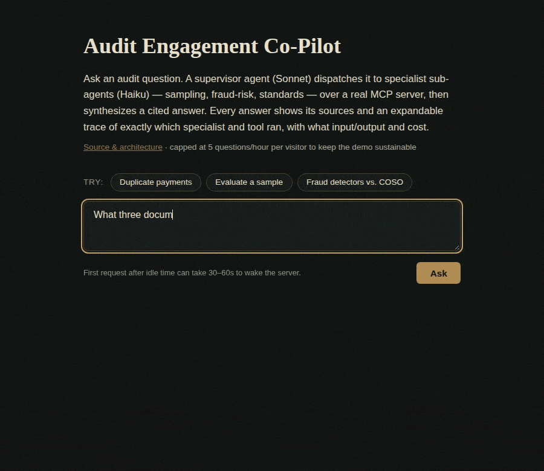
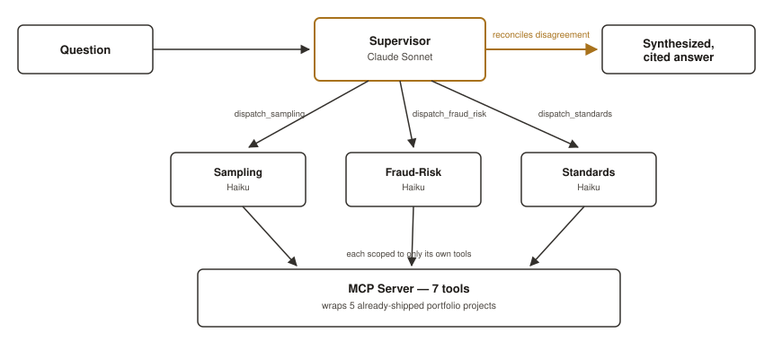
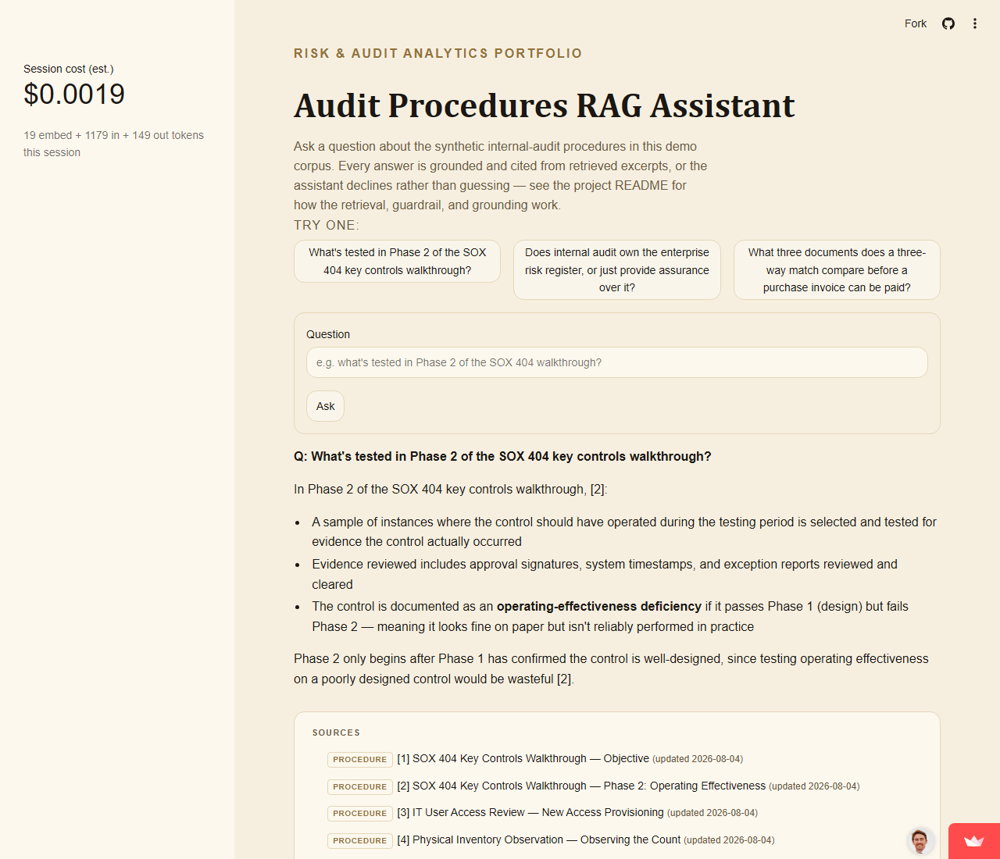
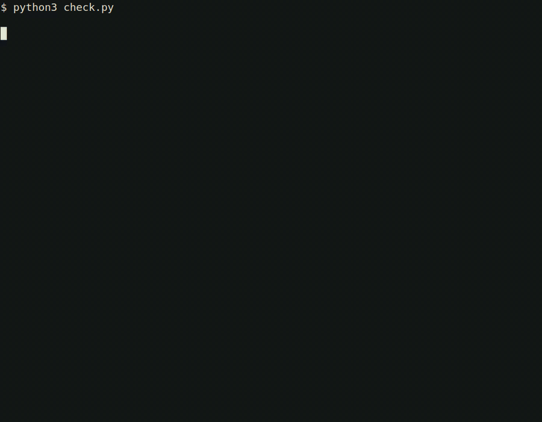

# Risk and audit analytics

Three projects are written out below. One splits an engagement question across the specialist that already owns each part. One answers from written procedures, or declines. One screens journal entries and labels which risk criterion fired. The rest of the work is a short list after that.

**[View the live site](https://neifertg.github.io/risk-analytics-portfolio/)**

## Projects

### Audit Engagement Co-Pilot

**Planning and fieldwork.** One engagement question across sampling, fraud risk, and written procedures, the kind of question that comes up while an engagement is planned and performed (Domain V of the Global Internal Audit Standards). In the Three Lines Model this sits with the third line, and the auditor still owns the conclusion.

**The audit problem.** An engagement question often needs a sampling answer, a fraud-risk answer, and a standards answer together. Those answers can disagree.

**What I built.** A supervisor that sends each part of the question to the specialist that already owns it, then returns one answer. If the specialists do not say the same thing, the disagreement stays in the answer.

**How it's used.** An auditor asks in plain language. The reply says which specialist handled which part. A figure from a practice dataset is labeled as such, rather than presented as a live-ledger result.

Under the hood

A Claude Sonnet supervisor dispatches to three Claude Haiku specialists over a shared tool server. The specialists call the sampling, fraud-risk, and procedure-search tools in this repo. Fraud-risk results are precomputed on seeded data. Packaged with Docker.

[Source](audit-engagement-co-pilot/)
· [Live demo](https://audit-engagement-co-pilot.onrender.com) (the free host sleeps when idle and can take a minute to wake)

### Audit Procedures RAG Assistant

**Fieldwork.** A procedure question is answered from the written library, or declined. That library is not the Global Internal Audit Standards.

**The audit problem.** A procedure question should be answered from the written procedures, or declined when those procedures do not support an answer.

**What I built.** Search over a written audit library. The answer comes back with the passages it used. If the search is too weak to support an answer, the assistant stops and does not guess.

**How it's used.** The auditor reads the cited passages next to the answer. The same question can be run on the generic procedure library, on public audit records from the University of California, or on both.

Under the hood

Two-stage search over a local database of procedure chunks. Embeddings are Voyage voyage-3-lite. The answer model is Claude Haiku. Below a set match score, the app declines before calling the model. The demo is a Streamlit app.

[Source](audit-rag-assistant/)
· [Live demo](https://84abkcnqvptyedbbssztx8.streamlit.app/) (the free host sleeps when idle and can take a minute to wake)

### Journal Entry Testing Analyzer

**Fieldwork: journal-entry testing.** In the IIA Three Lines Model, the third line screens entries the first line posted. The flag names the criterion; the reviewer decides whether it is a finding.

**The audit problem.** Journal-entry testing is a required fraud procedure under AU-C 240 and PCAOB AS 2401. A reviewer needs to see which risk criterion fired, not one combined score.

**What I built.** Separate checks for an unusual preparer, a weekend or holiday posting, period-end cutoff, a round-dollar amount with a weak description, and an unusual account combination. Round-dollar and weak description have to occur together, because either one alone is common in ordinary entries.

**How it's used.** Each flagged entry is marked with the criterion that caught it, so the review starts from that criterion. Period-end cutoff is a wide net on purpose: ordinary month-end posting falls in that window, and the screen is there to hand the reviewer a population, not a conclusion.

Under the hood

Python checks on a seeded general ledger. The file of planted entries is kept separate, and the checker does not read it.

[Source](journal-entry-testing-analyzer/)

## How I build AI an auditor can trust

- A person can check the work. The procedure assistant returns the passages it used. The engagement co-pilot names which specialist each part of the answer came from.
- Weak support is a decline, not a guess. If the best procedure match is below the cutoff, the assistant stops before calling the model.
- The procedure assistant's eval runs in CI on every push to main, in the job `audit-rag-assistant-eval`. It checks that the expected notes were retrieved, that the refusal fires only when it should, and that the answer contains the expected points. Pull requests do not run that live eval, so a fork cannot see the API keys. They run a syntax check and a test of the embedding retry instead. The co-pilot has its own eval script. That script is not in the CI workflow.
- Some citation cases are printed for a person to read. A citation used to contrast a source looks the same, to an automated check, as a citation that mixed two sources up. That flag is a review note. It does not by itself pass or fail the eval.
- This public repo has no client data. The procedure library is synthetic, plus public University of California audit documents. The ledgers, access lists, and sampling populations are seeded. The Benford screen uses public SEC filings. The two projects outside audit use public datasets.
- The co-pilot is instructed to keep a caveat that fraud-risk figures came from a seeded dataset, and to say so when two specialists point different ways. Both the procedure assistant and the co-pilot write a local log of the question, what was retrieved or which specialists ran, and the answer.

## Other work

- [Benford's Law Analyzer](benfords-law-analyzer/). Screens a set of financial figures for an unusual leading-digit pattern, using public company filings as the comparison.
- [Duplicate Vendor Payment Checker](duplicate-vendor-payment-checker/). Flags likely duplicate payments: exact repeats, invoices split under an approval limit, and lookalike vendor names.
- [Duplicate Payment Anomaly Detection](duplicate-payment-anomaly-detection/). Asks the same duplicate-payment question with the hand-built rules removed, to see what a general anomaly model recovers.
- [Segregation-of-Duties Conflict Checker](sod-conflict-checker/). Flags a person who currently holds both sides of a duty that should be split between two people.
- [Statistical Audit Sampling Calculator](sampling-calculator/). Plans an attribute or monetary-unit sample and checks the calculation against published audit tables.
- [Presentation Deck Builder](deck-builder/). Turns an outline into a consistent training deck. [Anomaly-detection deck](https://neifertg.github.io/risk-analytics-portfolio/deck-builder/decks/anomaly-detection-for-internal-audit/index.html) · [Clustering deck](https://neifertg.github.io/risk-analytics-portfolio/deck-builder/decks/clustering-for-audit/index.html)
- [Ames Housing Price Prediction](ames-housing-price-prediction/). Predicts home sale prices from a public housing dataset. Not an audit test.
- [IMDB Review Text Analytics](imdb-review-text-analytics/). Reads movie reviews for topics and sentiment. Not an audit test.

## Contact

- [GitHub](https://github.com/neifertg)
- [LinkedIn](https://www.linkedin.com/in/g-seth-neifert-7668b6b6/)
- [Email](mailto:gsneifert@gmail.com)
