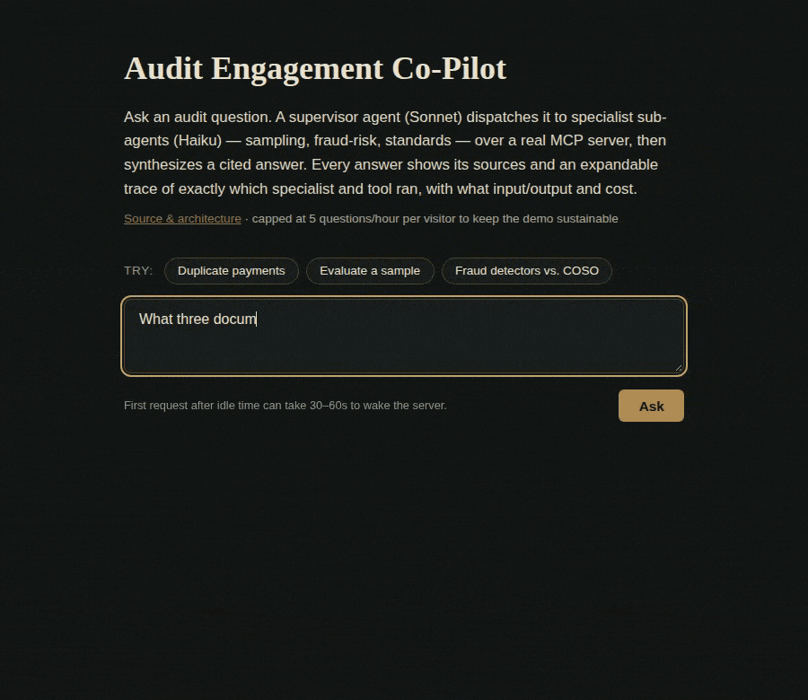
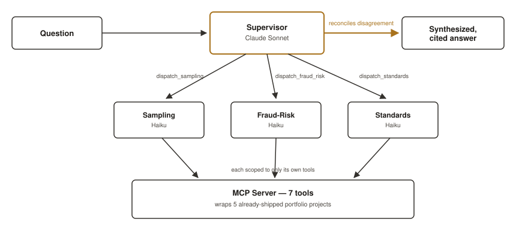
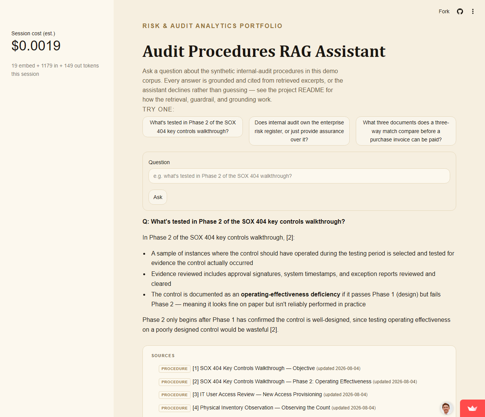
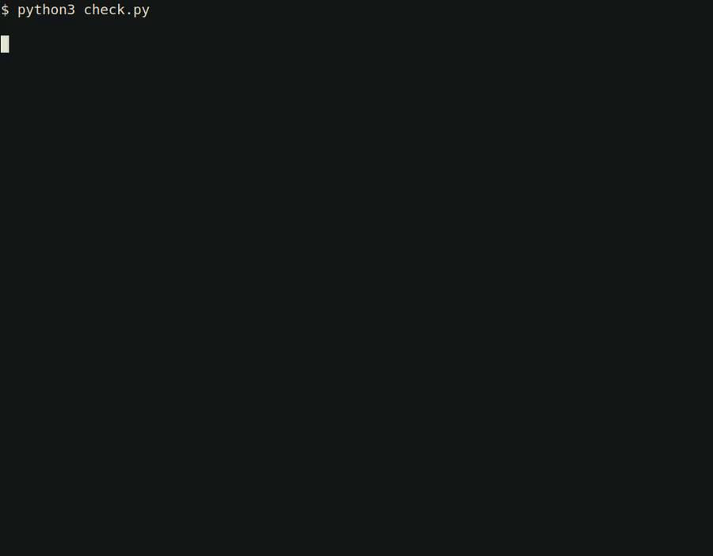

# Risk and audit analytics

Data scientist in financial services, building trustworthy AI for audit, risk and compliance.

## Projects {#projects}

### Audit Engagement Co-Pilot

**Planning and fieldwork.** One question can need a sample, a fraud screen, and a procedure answer together.

{: .demo-gif}

**Problem.** One question often needs a sampling answer, a fraud answer, and a standards answer, and those answers can disagree.

**What it does.** It sends each part to the specialist that already owns it, then returns one answer that keeps any disagreement.

**Why it's trustworthy.** The reply names who handled each part, and figures from practice data are labeled as practice data.

Under the hood

Three specialists each call only their own tools. Fraud-risk figures come from practice data.

[Source, architecture, and a trace example](https://github.com/neifertg/risk-analytics-portfolio/tree/main/audit-engagement-co-pilot)
· [Live demo](https://audit-engagement-co-pilot.onrender.com) (may take a minute to wake)

### Audit Procedures RAG Assistant

**Fieldwork.** A procedure question is answered from the written library, or declined.

{: .demo-gif}

**Problem.** The answer has to come from the written procedures, or stop when those procedures do not support one.

**What it does.** It searches a written audit library and returns the passages it used, or stops when the match is too weak.

**Why it's trustworthy.** The reader sees the cited passages beside the answer, so a weak match is a decline, not a guess.

Under the hood

It searches stored passages and stops before answering when the match is too weak. The same question can use the generic library, public University of California records, or both. Live recheck is on main only.

[Source and write-up](https://github.com/neifertg/risk-analytics-portfolio/tree/main/audit-rag-assistant)
· [Live demo](https://84abkcnqvptyedbbssztx8.streamlit.app/) (may take a minute to wake)

### Journal Entry Testing Analyzer

**Fieldwork.** Journal-entry testing.

{: .demo-gif}

**Problem.** A reviewer needs the rule that caught an entry, not one score that hides the rule.

**What it does.** It runs separate checks and marks every flagged entry with the rule that caught it.

**Why it's trustworthy.** Period-end cutoff is a wide net on purpose. It hands over a population, not a conclusion.

Under the hood

Required under AU-C 240 and PCAOB AS 2401. Checks: unusual preparer, weekend or holiday posting, period-end cutoff, a round amount with a weak description, and an unusual account pair. Practice ledger. Planted entries sit in a file the checker does not read.

[Source, findings, and output](https://github.com/neifertg/risk-analytics-portfolio/tree/main/journal-entry-testing-analyzer)

## How I build AI an auditor can trust

- A person can check the work: cited passages, or which specialist answered which part.
- A weak match is a decline, not a guess.
- The procedure assistant is rechecked on every update to the main branch.
- No client data. Ledgers are practice data. The Benford screen uses public filings.

## Other work

- [Benford's Law Analyzer](https://github.com/neifertg/risk-analytics-portfolio/tree/main/benfords-law-analyzer). Screens public filings for an unusual leading digit.
- [Duplicate Vendor Payment Checker](https://github.com/neifertg/risk-analytics-portfolio/tree/main/duplicate-vendor-payment-checker). Flags likely duplicate payments.
- [Duplicate Payment Anomaly Detection](https://github.com/neifertg/risk-analytics-portfolio/tree/main/duplicate-payment-anomaly-detection). Same question, without the hand-built rules.
- [Segregation-of-Duties Conflict Checker](https://github.com/neifertg/risk-analytics-portfolio/tree/main/sod-conflict-checker). Flags one person holding both sides of a split duty.
- [Statistical Audit Sampling Calculator](https://github.com/neifertg/risk-analytics-portfolio/tree/main/sampling-calculator). Plans a sample and checks it against published tables.
- [Presentation Deck Builder](https://github.com/neifertg/risk-analytics-portfolio/tree/main/deck-builder). Turns an outline into a training deck. [Anomaly deck](deck-builder/decks/anomaly-detection-for-internal-audit/index.html) · [Clustering deck](deck-builder/decks/clustering-for-audit/index.html)
- [Ames Housing Price Prediction](https://github.com/neifertg/risk-analytics-portfolio/tree/main/ames-housing-price-prediction). Predicts home prices from public data. Not an audit test.
- [IMDB Review Text Analytics](https://github.com/neifertg/risk-analytics-portfolio/tree/main/imdb-review-text-analytics). Reads reviews for topics and tone. Not an audit test.

## Contact {#contact}

- [GitHub](https://github.com/neifertg)
- [LinkedIn](https://www.linkedin.com/in/g-seth-neifert-7668b6b6/)
- [Email](mailto:gsneifert@gmail.com)
